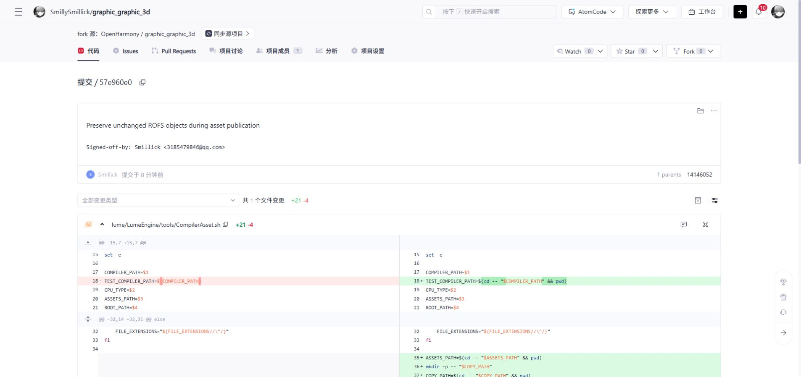

# GitCode 修复分支发布交接（2026-10-14）

**10 个个人仓的修复分支已推送并核对远端 SHA；7 个缺失的 fork 已创建。** 每仓统一分支名为 `fix/incremental-build-20261013`，日期对应修复版本。共 15 条新提交，作者、提交者和 DCO 均为 `Smillick <3185479846@qq.com>`。

这些分支覆盖新增修复涉及的 10 仓，并保留各仓迁移版所需的累计修复：相对编译基线合计 57 个文件，其中本轮新增规范性修改为 23 个文件、12 组根因。其余 7 个已归档仓本轮没有新增规范性修复，未重复推送；完整组合仍以 [17 仓源码交接](oct13-source-pr-handoff.md) 为准。

**本页记录的分支发布阶段新增 GitCode PR 为 0；后续已按原始 Action 顺序提交首条 [build #7130](https://gitcode.com/openharmony/build/pull/7130)，详见 [源 SA Action 交接](oct14-sa-profile-src-phone-pr.md)。** 个人仓 master 和旧 PR 源分支均保持推送前 SHA，因此旧 PR 不会自动包含这批新提交。后续提 PR 时选择本页的新分支，或按 Action 拆分相关补丁；同一根因不要与旧 PR 重复合入。

## 各仓地址、提交和作用

| 个人仓 | 已推送提交 | 累计 / 本轮文件数 | 修改与作用 |
| --- | --- | ---: | --- |
| [build](https://gitcode.com/SmillySmillick/build) | [`276b465e0bf1`](https://gitcode.com/SmillySmillick/build/commit/276b465e0bf190f179e1810af8827949f5cff4fe) | 36 / 4 | 保留 36 文件的累计修复；本轮新增 IDL 明确输出与 clean 恢复、components.json 稳定发布、安装规则 inputs，按迁移版与三个新增根因拆成四条提交。 |
| [third_party_jsframework](https://gitcode.com/SmillySmillick/third_party_jsframework) | [`39720b423300`](https://gitcode.com/SmillySmillick/third_party_jsframework/commit/39720b42330010ea5c306860f63a8637949efe8b) | 3 / 3 | 保留 JS 增量修复；新增 out 内构建、CSS 文件依赖、并行任务失败传播和 native 测试替身。 |
| [developtools_ace_ets2bundle](https://gitcode.com/SmillySmillick/developtools_ace_ets2bundle) | [`1eabff15841a`](https://gitcode.com/SmillySmillick/developtools_ace_ets2bundle/commit/1eabff15841a7ba11c860262bf2fbde2c3960db6) | 10 / 8 | 保留 libarkts 输出隔离；插件与 wrapper 在 out 生成，使用具体文件清单声明输入输出、稳定发布与 depfile。 |
| [account_os_account](https://gitcode.com/SmillySmillick/account_os_account) | [`b55c624c20ca`](https://gitcode.com/SmillySmillick/account_os_account/commit/b55c624c20ca24d4c64e98304fb5d3f975606a90) | 1 / 1 | 显式声明账户 IDL callback/common，补齐 clean 后的输出生产者。 |
| [inputmethod_imf](https://gitcode.com/SmillySmillick/inputmethod_imf) | [`331a15a1cda3`](https://gitcode.com/SmillySmillick/inputmethod_imf/commit/331a15a1cda376687080a3977999de42182ec3ec) | 1 / 1 | 显式声明 InputMethodClientTypes.idl 公共输出。 |
| [security_dlp_permission_service](https://gitcode.com/SmillySmillick/security_dlp_permission_service) | [`c5f19c2aad14`](https://gitcode.com/SmillySmillick/security_dlp_permission_service/commit/c5f19c2aad14e30ea3bf00c5ef49e9fbd2a74f28) | 1 / 1 | 显式声明 DlpPermissionTypes.idl 公共输出。 |
| [ability_dmsfwk](https://gitcode.com/SmillySmillick/ability_dmsfwk) | [`6d99e0fef7fe`](https://gitcode.com/SmillySmillick/ability_dmsfwk/commit/6d99e0fef7fe7b69f63f2445c8852303f055506d) | 1 / 1 | 显式声明 DeviceConnectStatus.idl 公共输出。 |
| [multimedia_audio_framework](https://gitcode.com/SmillySmillick/multimedia_audio_framework) | [`c1aafc5d32b0`](https://gitcode.com/SmillySmillick/multimedia_audio_framework/commit/c1aafc5d32b0b1ad6a429149090fda7b187ddf69) | 1 / 1 | 音频 callback 依赖共享 IDL 类型的实际生产者。 |
| [third_party_css-what](https://gitcode.com/SmillySmillick/third_party_css-what) | [`0ad16b63ecba`](https://gitcode.com/SmillySmillick/third_party_css-what/commit/0ad16b63ecbad73335b62474499f205b8848382c) | 2 / 2 | 具体文件 copy 输出及 fixture innerkit 导出，支持 jsframework 跨部件依赖。 |
| [graphic_graphic_3d](https://gitcode.com/SmillySmillick/graphic_graphic_3d) | [`57e960e087a2`](https://gitcode.com/SmillySmillick/graphic_graphic_3d/commit/57e960e087a2f0aefbcc5f21b0f88b6cefc354f0) | 1 / 1 | ROFS 对象临时生成后比较发布，输出缺失可恢复，失败保留已有有效产物。 |

可复制的仓地址与分支见 [纯文本清单](gitcode-published-branches-20261014.txt)。完整 SHA、父提交、逐文件列表、推送前后所有分支及校验信息见 [published.json](../patches/20261014-gitcode-publish/published.json)。

## 提交结构与合入依赖

- build：一条迁移累计修复提交，随后为 IDL、loader、安装规则三个根因的提交。累计分支包含历史十项相关修复，不能把全部差异说成单个新增 IDL PR。
- jsframework 和 ace_ets2bundle：各保留一条迁移累计修复，再追加一条本轮修复。JS 的 package-lock.json 未纳入。
- 七个新 fork：每仓一条 DCO 修复提交，直接基于该仓实际编译基线，不含临时快照提交。
- build IDL 与账户、输入法、DLP、分布式能力、音频的五仓消费者配套；CSS 导出先于或与 JS 消费者协调；SDK 插件/wrapper 连同迁移版 libarkts 输出隔离保留。

## 验证与上游差异

发布前逐文件比较，57 个修复文件与已通过 attempt6 编译的签名快照一致。所有新增提交通过身份与 DCO 校验、git diff --check；文本严格 UTF-8 解码，Python AST、JSON 和 shell 语法检查通过。补丁和 bundle 已在下载后核对 SHA-256。发布目录与实际构建源码分离，没有切换构建仓 HEAD、真实索引或 out，也没有启动新的产品编译。

当前上游 master 已通过网络获取到隔离发布仓。十仓的实际编译基线均为当前 master 的祖先；九仓修复文件没有上游重叠改动。build 的 `idl.gni` 在上游新增 OHOS 工具链选择，与本次修复作文本三方合并无冲突。这里仅说明路径重叠和文本合并检查通过，不代表当前最新 master 已完成组合编译或社区门禁。发布分支继续使用实际通过编译的基线，上游新功能会由后续 PR 合并保留。

已完成的产品验证仍为 [attempt6 全量及两轮增量](oct13-phone-norm-validation.md)：全量 2,105.50 秒；两轮增量 154.81 / 87.77 秒，原始十项均为 0。没有把这组结果重新归到未经编译的最新上游组合。

## 历史 PR 当前状态

公开 API 查询时间：`2026-10-14T06:36:40.358339+00:00`。13 个已知 PR 返回 open；12 个 mergeable=true，airscan #22 为 false。jsframework #853 的网页也显示已开启。mergeable 仅表示接口返回的冲突状态，不等于评审或门禁通过。完整响应字段见 [历史 PR 状态快照](evidence/20261014-gitcode-publish/historical-pr-status.json)。

| 历史 PR | 返回状态 | mergeable |
| --- | --- | --- |
| [build #6965](https://gitcode.com/openharmony/build/merge_requests/6965) | open | true |
| [build #6974](https://gitcode.com/openharmony/build/merge_requests/6974) | open | true |
| [build #6982](https://gitcode.com/openharmony/build/merge_requests/6982) | open | true |
| [build #6999](https://gitcode.com/openharmony/build/merge_requests/6999) | open | true |
| [build #7006](https://gitcode.com/openharmony/build/merge_requests/7006) | open | true |
| [build #7009](https://gitcode.com/openharmony/build/merge_requests/7009) | open | true |
| [build #7046](https://gitcode.com/openharmony/build/merge_requests/7046) | open | true |
| [build #7048](https://gitcode.com/openharmony/build/merge_requests/7048) | open | true |
| [build #7049](https://gitcode.com/openharmony/build/merge_requests/7049) | open | true |
| [third_party_iptables #62](https://gitcode.com/openharmony/third_party_iptables/merge_requests/62) | open | true |
| [developtools_packing_tool #1556](https://gitcode.com/openharmony/developtools_packing_tool/merge_requests/1556) | open | true |
| [third_party_jsframework #853](https://gitcode.com/openharmony/third_party_jsframework/merge_requests/853) | open | true |
| [third_party_sane-airscan #22](https://gitcode.com/openharmony/third_party_sane-airscan/merge_requests/22) | open | false |

## 保存与恢复

每仓同时保存 `.patch` 和增量 `.bundle` 于 [发布归档目录](../patches/20261014-gitcode-publish/)。bundle 依赖 published.json 中的上游 base 对象，须在已有相应 OpenHarmony 仓中使用；它不是脱离上游历史的完整镜像。远端隔离发布仓与本地原始导出也各保留一份。

远端发布目录：

```text
/srv/workspace/openharmony_master_default_20261012175945_huawei_3f7104f86/phone_norm_validation_20261013/gitcode-publish-20261013
```

本地归档：

```text
D:\workspace\archives\20261012-migration\gitcode-publish-20261013
```

GitCode 新提交页面中的签名与修改：


