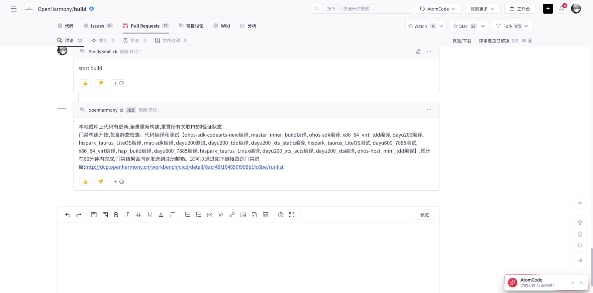

# SA 组三个 Action 的旧 PR 更新（2026-10-14）

[build #6965](https://gitcode.com/openharmony/build/pull/6965) 继续统一提交 `sa_profile_src_phone`、`sa_profile_binary_phone` 和 `phone_sa_profile_install_info`，关联原 [Issue #4657](https://gitcode.com/openharmony/build/issues/4657)。

## 源码更新

旧 PR 的五个文件中，四个与当前组合修复版一致；本次仅追加 `ohos/sa_profile/sa_profile_binary.py` 的 ZIP 元数据时间戳修复，新增 3 行、删除 1 行。`part_name_info.json` 使用 `build_utils.HERMETIC_TIMESTAMP`，避免元数据内容相同却因写入时间变化导致 ZIP 字节变化。

- 更新前提交：`0d530d7eb691276cd27d7109b1155a21c6c0c1cc`。
- 更新后提交：`f15f9bded74ae12a75b8a9ef729c1397a7202ec2`。
- 原源分支 `codex/fix-sa-profile-incremental-build` 保持原名；正常追加推送，没有强制覆盖。这个名称为历史分支，并非新建。
- DCO：`Signed-off-by: Smillick <3185479846@qq.com>`。
- 五个 SA 文件与组合修复版 `276b465e0bf190f179e1810af8827949f5cff4fe` 一致；AST、差异格式和当前 master 的文本合并检查通过。实际构建仓、raw 和 out 未修改。

## PR 与 Issue 整理

PR 描述已更新为[确认后的简短正文](pr-drafts/20261014/sa-profile-group.md)，只说明触发原因、修复方式和预期结果。

重复 [PR #7130](https://gitcode.com/openharmony/build/pull/7130) 已关闭；临时 [Issue #4759](https://gitcode.com/openharmony/build/issues/4759) 已设为“已取消”，页面显示已关闭。代码分支与历史记录保留。

门禁会拒绝同仓、同目标分支的多个开放 PR 关联同一个 Issue。原先将 #7130 和 #6965 同时关联 #4657 的方案已撤回。后续沿历史 PR 分组更新，不按每个 Action 强行拆分；新增或改写 PR 正文先完成确认。

## 门禁启动

关闭重复项后，在 #6965 发送一次 `start build`。机器人已回复“门禁构建开始”，并说明本地或库上代码有更新，将全量重新构建。

[首次门禁任务](https://dcp.openharmony.cn/workbench/cicd/detail/6acf48f164650f998b1fc6be/runlist) 已结束：静态检查通过，PR 标记“编译成功”，冒烟因 `dayu600_7885` 的 `failed(ecotest timeout)` 未通过。历史 8 月门禁成功不作为此次提交通过的依据。

### 冒烟超时排查与重试

- `dayu600_7885` 编译结果为 success；`dayu200` 和 `hispark_taurus_LiteOS` 的编译、冒烟均通过。
- 失败项的测试报告链接为空，门禁详情点击测试失败后提示“未生成日志文件”。测试总时间、调度、升级、检查设备、测试执行栏均为 `--`，没有具体失败用例或断言日志。
- `master_inner_build`、`x86_64_virt_tdd`、`ohos-sdk-codearts-new` 的失败均标为 IGNORE，不是这次冒烟失败的阻断项。
- 现有报告更符合 EcoTest 平台超时，未发现指向 SA 修复的错误。缺少底层测试日志，不能进一步区分设备资源、调度服务或其他超时原因；不据此宣称源码在所有平台均无问题。
- 保持源码 HEAD `f15f9bded74ae12a75b8a9ef729c1397a7202ec2` 和 PR 描述不变，在 #6965 评论一次 `start build` 重试。

机器人已确认“门禁构建开始”，选择全量重新构建并重置旧验证标签。新任务为 [6acfa28164650f998b3e5d24](https://dcp.openharmony.cn/workbench/cicd/detail/6acfa28164650f998b3e5d24/runlist)，当前只确认启动，尚无完成结果。重试评论 ID 为 `193834698`，机器人回执 ID 为 `193834740`。

证据：[失败目标原文](evidence/20261014-sa-smoke-retry/failed-pr.txt)、[门禁详情截图](evidence/20261014-sa-smoke-retry/failed-gate.png)、[重试回执](evidence/20261014-sa-smoke-retry/retry-started.txt)、[重试启动截图](evidence/20261014-sa-smoke-retry/retry-started.png)。

## 归档

**全量修复入口：** [本轮 17 个相关仓的离线源码](oct14-all-repairs-offline.md) 位于 `D:/workspace/repositories/openharmony-repairs-20261014`，包含所有累计修复及本轮新增规范性修改。该目录的 build 仓同时保留组合验证分支和 `review/sa-profile-pr6965-20261014`；下面的目录仅对应 SA 组独立 PR。

本地完整 build 源码仓：`D:/workspace/repositories/build-sa-pr6965-20261014`。分支为 `fix/sa-profile-incremental-20261014`，HEAD 为 `f15f9bded74ae12a75b8a9ef729c1397a7202ec2`，对应更新后的 #6965。该目录从本地历史仓与 bundle 独立恢复，工作树干净，Git 对象连接检查通过，没有 alternates 依赖。离线可查看、修改这组源码；完整 OpenHarmony 产品源码、工具链和 out 未复制，整仓构建仍需原环境。

旧目录 `repositories/openharmony-build-sa` 中的未提交修改保留。此前 17 仓（含 build）的修复补丁和版本记录仍在 `patches/20261013-source-handoff/`，不能将这些增量归档视为完整产品源码镜像。

- [发布记录](../patches/20261014-sa-profile-group/published.json)
- [追加修复补丁](../patches/20261014-sa-profile-group/update.patch)与 [bundle](../patches/20261014-sa-profile-group/update.bundle)
- [更新前补丁](../patches/20261014-sa-profile-group/pr6965-before-update.patch)与 [bundle](../patches/20261014-sa-profile-group/pr6965-before-update.bundle)
- [门禁启动页面记录](evidence/20261014-sa-profile-group/gate-started.txt)
- [重复 PR 关闭截图](evidence/20261014-sa-profile-group/pr7130-closed.jpg)、[临时 Issue 关闭截图](evidence/20261014-sa-profile-group/issue4759-closed.jpg)

