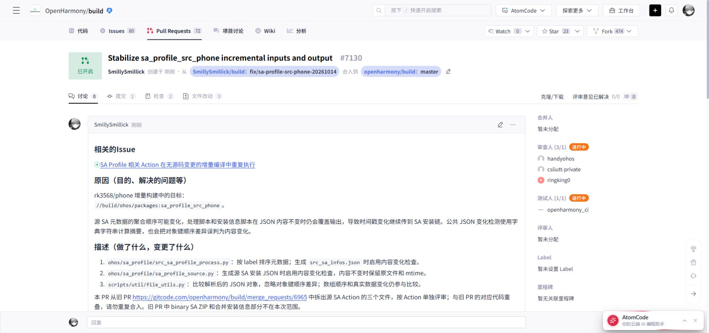

# sa_profile_src_phone PR 交接（2026-10-14）

**本页为拆分阶段的历史记录。当前三个 SA Action 已恢复由 [build #6965](https://gitcode.com/openharmony/build/pull/6965) 一起提交；#7130 与临时 Issue #4759 已关闭，见 [SA 组更新交接](oct14-sa-profile-group-update.md)。**

原始第一项 Action `//build/ohos/packages:sa_profile_src_phone` 已通过浏览器提交为 [openharmony/build #7130](https://gitcode.com/openharmony/build/pull/7130)，正式关联已有 [Issue #4657](https://gitcode.com/openharmony/build/issues/4657)。本次仅创建这一条 PR。

## Git 版本与提交范围

| 项目 | 内容 |
| --- | --- |
| 目标 | `openharmony/build:master` |
| 源分支 | `SmillySmillick/build:fix/sa-profile-src-phone-20261014` |
| 基线 | `86a670af8b35b1eb941b995f5ff1a613460532bc` |
| 提交 | `8334993c47ae5d557f4f47b74b942103d94a37cc` |
| DCO | `Signed-off-by: Smillick <3185479846@qq.com>` |
| 范围 | 1 条提交，3 个文件，新增 9 行、删除 16 行 |

该分支在远端隔离发布仓中创建，推送后已核对远端 SHA。没有切换实际构建源码、raw 对照仓或 out。三个文件的 Git blob 与已完成组合构建的累计分支 `276b465e0bf190f179e1810af8827949f5cff4fe` 一致。

| 文件 | 修改与作用 |
| --- | --- |
| `ohos/sa_profile/src_sa_profile_process.py` | 按 label 排序 SA 元数据；`src_sa_infos.json` 按内容变化写入，避免输入聚合顺序及重复发布改变 mtime。 |
| `ohos/sa_profile/sa_profile_source.py` | 源 SA 安装 JSON 启用内容变化检查，内容不变时保留文件和 mtime，实际变化仍更新。 |
| `scripts/util/file_utils.py` | 比较解析后的 JSON 对象，忽略对象键顺序差异，保留数组顺序和真实数据变化的检查；输出缺失时重新生成。该 helper 为公共代码，其他启用检查的调用方也受影响。 |

## 旧 PR、Issue 与依赖关系

- 从旧 [build #6965](https://gitcode.com/openharmony/build/merge_requests/6965) 中拆出源 SA 部分；旧 PR 的 binary SA ZIP 和合并安装信息不在本 PR 范围。新旧代码存在重叠，不应重复合入。旧 PR 本次未关闭、未改动。
- Issue #4657 覆盖多个 SA Action。拆分时曾将 #7130 与 #6965 同时关联它，随后被门禁以“同仓同分支存在多个 PR 关联相同 Issue”拒绝。当前恢复由 #6965 统一关联，不能沿用同仓同目标分支复用 Issue 的拆分方案。
- 完整零改动增量中，该 Action 不执行还依赖上游 parts 元数据稳定化（build #6999、#7009）。上游输入真实变化时仍应执行。
- 合并后删除源分支与 Squash 均未启用。

## 验证与当前门禁

Python AST、`git diff --check` 通过。使用真实脚本及当前上游 helper 完成八项隔离回归：

1. 源部件筛选、平台命名、label 排序和工具链 depfile 正确。
2. 相同输入重复执行，两级 JSON 内容及纳秒级 mtime 均不变。
3. 调换 SA 元数据输入顺序，两级输出不重写。
4. JSON 对象键顺序变化不触发重写。
5. JSON 数组顺序变化仍触发更新。
6. 实际 SA 元数据变化能传到两级输出。
7. 源部件选择变化能更新安装列表。
8. 删除任一生成 JSON 后可恢复预期内容。

既有 [attempt6 组合构建](oct13-phone-norm-validation.md) 从空 out 完成全量和连续两轮增量，均退出 0，两轮本 Action 均未执行；耗时分别为 2105.50 / 154.81 / 87.77 秒。组合中包含其他 Action 的配套修复，不能归为本 PR 单独收益。**本拆分分支未重新执行独立整仓构建。**

创建后浏览器页面确认：PR 已开启，Issue #4657 已关联，机器人标记“dco检查成功”；代码审查尚未通过，社区构建尚未手动触发。没有把 DCO 通过视为编译门禁通过。

后续沿用原有 PR 分组，三个 SA Action 不再分别新建 PR。

## 归档

- [已提交的 PR 正文](pr-drafts/20261014/sa-profile-src-phone.md)
- [验证报告](../patches/20261014-sa-profile-src-phone/report.json)
- [源码补丁](../patches/20261014-sa-profile-src-phone/source.patch)
- [Git bundle](../patches/20261014-sa-profile-src-phone/source.bundle)：增量 bundle，需要已有上述基线及其历史。
- [浏览器页面记录](evidence/20261014-sa-profile-src-phone/pr-created.txt)

