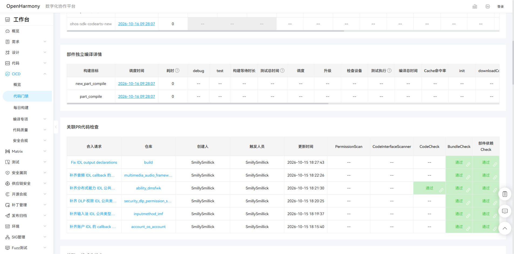

# 配套 PR 提交与联合门禁交接（2026-10-15）

10 条配套 PR 已创建，新增 loader Issue #4761；全部新增 PR 的 DCO 检查通过。HAP 两条旧 PR 已统一关联 build #4663，packing_tool #1201 保留开放历史记录且不再承担正式 PR 分组。

六组各发送一次 `start build`，全部收到“门禁构建开始”回执。16 条组内 PR 都收到对应的同一组任务链接，未出现同仓同分支重复 PR 拦截。提交完成时状态为已启动；后续结果以巡检记录为准。

记录日期采用 America/Los_Angeles 的 2026-10-15；GitCode 回执时间采用北京时间 2026-10-16 09:28–09:30。

## 最新巡检

自动任务 `openharmony-30` 已暂停。最后一次自动读取为 [2026-10-16 07:48 UTC](evidence/20261015-companion-prs/monitor/20261016T074849Z/summary.md)，状态没有变化。随后 SDK #36540 与 ace #7210 完成静态检查写法修订并推送原分支；新提交尚未重新触发门禁。SA、HAP 平台故障保留。修订版本、11 项验证及 ringking0 对应的五条通过 PR 见 [10 月 16 日交接](oct16-codecheck-fixes.md)。

## PR、文件与作用

| 仓库 / PR | 修改文件 | 修复作用 | Issue |
| --- | --- | --- | --- |
| [account_os_account #3898](https://gitcode.com/openharmony/account_os_account/merge_requests/3898) | `frameworks/osaccount/native/BUILD.gn` | 在 frameworks_osaccount_interface 中声明 IDomainAccountCallback.idl 和 DomainAccountIpcData.idl 的输出，与 build 的 IDL 模板修复配套。 | [#4668](https://gitcode.com/openharmony/build/issues/4668) |
| [inputmethod_imf #2774](https://gitcode.com/openharmony/inputmethod_imf/pull/2774) | `interfaces/inner_api/inputmethod_controller/BUILD.gn` | 在 input_client_interface 中通过 sources_common 声明 InputMethodClientTypes.idl 的公共输出。 | [#4668](https://gitcode.com/openharmony/build/issues/4668) |
| [security_dlp_permission_service #953](https://gitcode.com/openharmony/security_dlp_permission_service/pull/953) | `interfaces/inner_api/dlp_permission/BUILD.gn` | 在 dlp_permission_interface 中通过 sources_common 声明 DlpPermissionTypes.idl。 | [#4668](https://gitcode.com/openharmony/build/issues/4668) |
| [ability_dmsfwk #2123](https://gitcode.com/openharmony/ability_dmsfwk/pull/2123) | `interfaces/innerkits/common/BUILD.gn` | 在 dmsfwk_idl 中通过 sources_common 声明 DeviceConnectStatus.idl 的公共输出。 | [#4668](https://gitcode.com/openharmony/build/issues/4668) |
| [multimedia_audio_framework #17444](https://gitcode.com/openharmony/multimedia_audio_framework/pull/17444) | `services/audio_service/idl/BUILD.gn` | 让 audio_service_idl_callback 显式依赖 audio_service_idl_interface，先生成共享类型，再处理 callback。 | [#4668](https://gitcode.com/openharmony/build/issues/4668) |
| [third_party_css-what #29](https://gitcode.com/openharmony/third_party_css-what/pull/29) | `BUILD.gn` `bundle.json` | 将源码和 fixture 分别声明为具体文件复制目标，保留 runtime/src 布局，并在 bundle.json 中导出 fixture innerkit。 | [#323](https://gitcode.com/openharmony/third_party_jsframework/issues/323) |
| [interface_sdk-js #36540](https://gitcode.com/openharmony/interface_sdk-js/pull/36540) | `BUILD.gn` `process_internal.py` `remove_internal.py` | 为拆分和声明裁剪接入 stamp、depfile，跟踪声明文件及裁剪规则。裁剪结果先生成到临时目录，内容相同时保留原输出；不带新参数的调用保留原有行为。 | [#4706](https://gitcode.com/openharmony/build/issues/4706) |
| [developtools_ace_ets2bundle #7210](https://gitcode.com/openharmony/developtools_ace_ets2bundle/pull/7210) | `arkui-plugins/BUILD.gn` `arkui-plugins/build_ui_plugins.py` `arkui-plugins/sdk_files.json` `ets1.2/BUILD.gn` `ets1.2/libarkts/BUILD.gn` `koala-wrapper/BUILD.gn` `koala-wrapper/build_ts_wrapper.py` `koala-wrapper/sdk_files.json` `sdk_copy.gni` `sdk_files.py` | 将插件和 wrapper 放到 out 内构建，用具体文件清单声明输入输出并按内容发布，补齐 package.json 和工具依赖，隔离 libarkts 输出；清单包含主干新增的校验文件。 | [#4704](https://gitcode.com/openharmony/build/issues/4704) |
| [graphic_graphic_3d #676](https://gitcode.com/openharmony/graphic_graphic_3d/pull/676) | `lume/LumeEngine/tools/CompilerAsset.sh` | 在构建目录的临时目录生成对象，检查输出后比较内容，仅替换有变化的文件。 | [#4704](https://gitcode.com/openharmony/build/issues/4704) |
| [build #7134](https://gitcode.com/openharmony/build/pull/7134) | `hb/services/loader.py` `scripts/util/file_utils.py` | 取消写回前的删除，使用 check_changes 比较后写入；公共 JSON 判断改为比较解析后的内容。 | [#4761](https://gitcode.com/openharmony/build/issues/4761) |

## 联合门禁分组与回执

| 分组 | Issue | 组内 PR | 门禁任务 / 回执 |
| --- | --- | --- | --- |
| IDL | [#4668](https://gitcode.com/openharmony/build/issues/4668) | [build #6982](https://gitcode.com/openharmony/build/merge_requests/6982)、[account_os_account #3898](https://gitcode.com/openharmony/account_os_account/merge_requests/3898)、[inputmethod_imf #2774](https://gitcode.com/openharmony/inputmethod_imf/merge_requests/2774)、[security_dlp_permission_service #953](https://gitcode.com/openharmony/security_dlp_permission_service/merge_requests/953)、[ability_dmsfwk #2123](https://gitcode.com/openharmony/ability_dmsfwk/merge_requests/2123)、[multimedia_audio_framework #17444](https://gitcode.com/openharmony/multimedia_audio_framework/merge_requests/17444) | [运行详情](http://dcp.openharmony.cn/workbench/cicd/detail/6ad17dba64650f998bd49019/runlist)；命令 `194069100`，开始回执 `194069319` |
| JS-CSS | [#323](https://gitcode.com/openharmony/third_party_jsframework/issues/323) | [third_party_jsframework #853](https://gitcode.com/openharmony/third_party_jsframework/merge_requests/853)、[third_party_css-what #29](https://gitcode.com/openharmony/third_party_css-what/merge_requests/29) | [运行详情](http://dcp.openharmony.cn/workbench/cicd/detail/6ad17dce64650f998bd497ca/runlist)；命令 `194069203`，开始回执 `194069346` |
| SDK-split | [#4706](https://gitcode.com/openharmony/build/issues/4706) | [build #7049](https://gitcode.com/openharmony/build/merge_requests/7049)、[interface_sdk-js #36540](https://gitcode.com/openharmony/interface_sdk-js/merge_requests/36540) | [运行详情](http://dcp.openharmony.cn/workbench/cicd/detail/6ad17ded64650f998bd4a4d2/runlist)；命令 `194069312`，开始回执 `194069494` |
| Install | [#4704](https://gitcode.com/openharmony/build/issues/4704) | [build #7046](https://gitcode.com/openharmony/build/merge_requests/7046)、[developtools_ace_ets2bundle #7210](https://gitcode.com/openharmony/developtools_ace_ets2bundle/merge_requests/7210)、[graphic_graphic_3d #676](https://gitcode.com/openharmony/graphic_graphic_3d/merge_requests/676) | [运行详情](http://dcp.openharmony.cn/workbench/cicd/detail/6ad17dfc64650f998bd4ac9f/runlist)；命令 `194069388`，开始回执 `194069543` |
| HAP | [#4663](https://gitcode.com/openharmony/build/issues/4663) | [build #6974](https://gitcode.com/openharmony/build/merge_requests/6974)、[developtools_packing_tool #1556](https://gitcode.com/openharmony/developtools_packing_tool/merge_requests/1556) | [运行详情](http://dcp.openharmony.cn/workbench/cicd/detail/6ad17e0a64650f998bd4b234/runlist)；命令 `194069463`，开始回执 `194069579` |
| loader | [#4761](https://gitcode.com/openharmony/build/issues/4761) | [build #7134](https://gitcode.com/openharmony/build/merge_requests/7134) | [运行详情](http://dcp.openharmony.cn/workbench/cicd/detail/6ad17e2c64650f998bd4c86f/runlist)；命令 `194069576`，开始回执 `194069658` |

同一 Issue 内各仓库与目标分支组合均唯一。IDL 为六仓、JS/CSS 为两仓、SDK split 为两仓、安装组为三仓、HAP 为两仓、loader 为单仓。不同组的 build/master PR 保持分开，避免门禁拒绝。

build #4668、#4706、#4704、#4663 和 jsframework #323 的正文已替换为实际 PR 清单，5/5 回读一致。packing_tool #1556 正文仅将 Issue URL 从 #1201 换为 #4663，源码 HEAD 未改，旧 Issue 仍 open。GitCode 对 PR 正文中的 Issue URL 异步建立正式关联，必须等后台生效后用关联接口回读；Issue 正文中的普通 PR 参考链接不等于加入门禁组。

## 源码版本与保存位置

主归档仓修改前 HEAD 为 `05da74046fca22b956c380d4a59e5fe8739c2810`，备份标签为 `backup/companion-pr-drafts-20261015`。相关源码仓准备前已创建 `backup/companion-prs-20261015`。

本次实际补充源码：ace_ets2bundle 对齐当日 master 后，将新增 `check-builder-decorator-arguments.ts` 及对应 JS 输出加入 `arkui-plugins/sdk_files.json`。SDK 调用方与 loader 从已有累计修复拆出独立范围。八个既有发布分支中，七个保持原代码，ace 增加上述主干兼容补充。

新增整理版本位于 `D:/workspace/repositories/companion-prs-20261015`；既有源码快照位于 `D:/workspace/repositories/openharmony-repairs-20261014`，完整路径见 [PR 清单](evidence/20261015-companion-prs/created-prs.json)。

| PR | 发布分支 | HEAD |
| --- | --- | --- |
| account_os_account #3898 | `fix/incremental-build-20261013` | `b55c624c20ca24d4c64e98304fb5d3f975606a90` |
| inputmethod_imf #2774 | `fix/incremental-build-20261013` | `331a15a1cda376687080a3977999de42182ec3ec` |
| security_dlp_permission_service #953 | `fix/incremental-build-20261013` | `c5f19c2aad14e30ea3bf00c5ef49e9fbd2a74f28` |
| ability_dmsfwk #2123 | `fix/incremental-build-20261013` | `6d99e0fef7fe7b69f63f2445c8852303f055506d` |
| multimedia_audio_framework #17444 | `fix/incremental-build-20261013` | `c1aafc5d32b0b1ad6a429149090fda7b187ddf69` |
| third_party_css-what #29 | `fix/incremental-build-20261013` | `0ad16b63ecbad73335b62474499f205b8848382c` |
| interface_sdk-js #36540 | `fix/sdk-interface-incremental-20261015` | `9e2c44a2cca432c7686c396ab9465ea51c1119da` |
| developtools_ace_ets2bundle #7210 | `fix/incremental-build-20261013` | `a9bc178d4d9bcc0f1179f24ef1b620d51537f4d6` |
| graphic_graphic_3d #676 | `fix/incremental-build-20261013` | `57e960e087a2f0aefbcc5f21b0f88b6cefc354f0` |
| build #7134 | `fix/loader-components-incremental-20261015` | `f0dd0bd6ea0708337120d8044115e87491794532` |

所有修复提交带 `Signed-off-by: Smillick <3185479846@qq.com>`。远端分支 SHA 与 PR HEAD 均已回读核对；ace_ets2bundle 使用追加合并提交，没有强推历史分支。

[本次三份补丁与增量 bundle](../patches/20261015-companion-prs/) 保存 SDK、loader 和 ace 刷新版本；bundle 依赖已有上游/旧修复父提交，不能当作完整仓库克隆包。其他已发布分支和历史完整快照沿用 [GitCode 发布归档](oct14-gitcode-publish.md) 与 [离线源码交接](oct14-all-repairs-offline.md)。

## 验证范围

- UTF-8、范围内 diff、提交 DCO、工作树状态和当前上游合并关系检查完成。
- SDK 拆分/声明裁剪检查了输入变化、无变化时间戳、缺失输出恢复、depfile 与失败保留旧输出。
- loader 检查了 JSON 字典键顺序、列表顺序真实变化、稳定时间戳和缺失输出恢复。
- 插件/wrapper 受控输入与生成 JS 清单已按当前主干核对；补齐新增 validator。
- 本次没有重新执行远程产品全量或增量构建。此前组合版本的 2,105.50 秒全量、154.81 / 87.77 秒增量是历史验证，不代替本次主干适配后的六组门禁结果。

准备阶段 13 项检查见 [发布前验证](evidence/20261015-companion-prs/prepublish-verification.json)，其中门禁字段记录的是发布前状态。发布后以 [提交核对](evidence/20261015-companion-prs/submitted-audit.json)、[全部成员回执](evidence/20261015-companion-prs/final-verification.json) 和 [门禁任务](evidence/20261015-companion-prs/gate-receipts.json) 为准。

## 后续巡检

`openharmony-30` 已暂停，不再自动检查。下述规则保留供后续恢复时使用：每 30 分钟检查最新提交对应门禁。通过后移出检查范围；运行中继续等待；失败时读取首个真实报错，区分代码、依赖兼容和平台环境问题。相同状态保持安静，仅新故障、原因查明或需要操作时反馈。不自动重复触发门禁。

初始巡检清单见 [monitor-state.json](evidence/20261015-companion-prs/monitor-state.json)。同组 PR 按一个构建任务去重；任何源码更新后，旧成功状态均不能代替新 HEAD 的结果。全部目标通过或已关闭/合入后停止巡检。

IDL 构建中心实际六仓成员截图：

## 10 月 16 日门禁重跑

SA、HAP 两组静态检查通过，已分别启动一次失败项重跑，见[启动回执及范围](oct16-manual-gate-retrigger.md)。自动巡检保持暂停。
